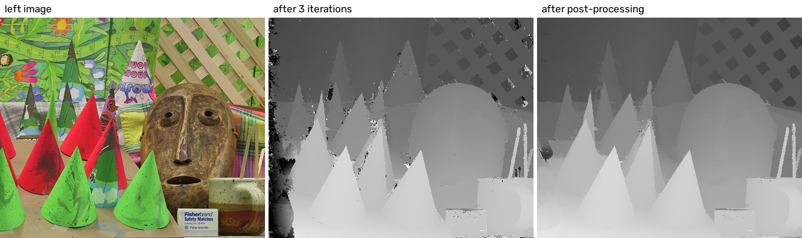

# PatchMatchStereo

A compact Python implementation of [PatchMatch Stereo — Stereo Matching with Slanted Support Windows](https://www.microsoft.com/en-us/research/wp-content/uploads/2011/01/PatchMatchStereo_BMVC2011_6MB.pdf) (Bleyer, Rhemann & Rother, BMVC 2011), accelerated with [Numba](https://numba.pydata.org/).

Instead of assigning each pixel a fronto-parallel disparity, PatchMatch Stereo estimates a **slanted disparity plane** per pixel, which models tilted surfaces correctly and yields sub-pixel disparities. Good planes are found surprisingly fast with PatchMatch-style random search: start from random planes, then alternately propagate good planes from neighbors (and from the other view) and refine them with a shrinking random search.



## What's Implemented

The full stereo pipeline of the paper (everything except temporal propagation, which is for video):

- **Per-pixel slanted planes**: each pixel carries a plane `d = a·x + b·y + c`, which is evaluated over the whole support window
- **Adaptive support-weight matching cost** (Eq. 3–5): truncated color + gradient dissimilarity, weighted by color similarity to the window center, with matching points sampled at sub-pixel positions by linear interpolation
- **Random initialization**: random disparity in `[0, max_disp]` and random unit normal per pixel, for both views
- **Spatial propagation**: alternating top-left → bottom-right / bottom-right → top-left passes that adopt a neighbor's plane when it lowers the cost
- **View propagation**: pixels of the other view that map onto the current pixel contribute their plane, transformed into the current view
- **Plane refinement**: random perturbation of disparity and normal with exponentially shrinking search ranges
- **Post-processing**: left/right consistency check, filling of invalid pixels with the background plane of the nearest valid neighbor, and a weighted median filter on the filled pixels

All pixels on an anti-diagonal are independent during a pass, so each pass runs in parallel over anti-diagonals. Every pixel draws its own deterministic random numbers, so a given `--seed` gives exactly the same result as a sequential raster scan, whatever the thread count.

## Run

```bash
pip install opencv-python numpy numba
python main.py
```

The demo runs 3 iterations on the bundled Middlebury *Cones* pair (`im2.png` / `im6.png`, max disparity 60). It takes about 30 s on 4 CPU cores (the first run includes a few seconds of JIT compilation, which is cached afterwards). It writes these files to `results/`:

| File | Content |
| --- | --- |
| `disp_left.png`, `disp_right.png` | final disparity maps (scaled by `255 / max_disp`) |
| `raw_left.png`, `raw_right.png` | disparity maps before post-processing |
| `disp_left.npy`, `disp_right.npy` | final disparities as float32 arrays |

To run on your own rectified pair, or evaluate against ground truth:

```bash
python main.py left.png right.png --max-disp 64 --iters 3 --out results
```

```bash
python main.py im2.png im6.png --gt disp2.png --gt-scale 4
```

`--gt` reports the percentage of pixels with an error above 1 pixel, counting only pixels with known ground truth. Middlebury 2003 ground truth stores 4 × disparity, hence `--gt-scale 4`. Other options: `--window`, `--gamma`, `--alpha`, `--tau-col`, `--tau-grad` (defaults are the paper's values: 35, 10, 0.9, 10, 2), `--no-post`, `--seed` and `--show`.

It can also be used as a library:

```python
import cv2
from main import patchmatch_stereo

res = patchmatch_stereo(cv2.imread('im2.png'), cv2.imread('im6.png'), max_disp=60)
disp = res['disp_left']  # float disparity map; also raw_*, valid_*, planes_*
```

## Reference

```bibtex
@inproceedings{bleyer2011patchmatch,
  title={PatchMatch Stereo - Stereo Matching with Slanted Support Windows},
  author={Bleyer, Michael and Rhemann, Christoph and Rother, Carsten},
  booktitle={British Machine Vision Conference (BMVC)},
  year={2011}
}
```
