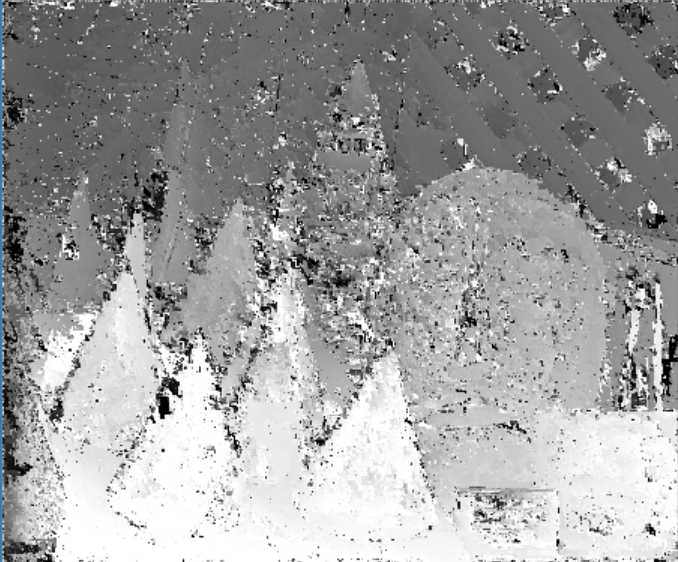

# PatchMatchStereo

<!-- README refined by Cursor -->

https://www.microsoft.com/en-us/research/wp-content/uploads/2011/01/PatchMatchStereo_BMVC2011_6MB.pdf

## Overview

This repository contains Python code from an older research, course, or prototype project. The README has been refreshed to make the repository easier to scan while preserving the original notes below.

## Repository Contents

- Top-level source files and project assets.

## Setup

- This legacy repo does not pin a full environment. Start from the language/toolchain implied by the source files, then install missing packages as reported by the runtime.

## Usage

- `python main.py`

## Data and Artifacts

No new large artifact is stored in this repository. If a dataset or checkpoint is required, follow the links and notes in the original section below.

## Status

This is a `Batch B` cleanup pass for a legacy repository. Commands may require dependency/version adjustments on a modern machine.

## License

No explicit license file was found in this checkout; check the original project context before reusing code.

## Original Notes

# PatchMatchStereo
https://www.microsoft.com/en-us/research/wp-content/uploads/2011/01/PatchMatchStereo_BMVC2011_6MB.pdf

# Description
This repo (partially) implements patch match stereo algorithm described in the paper.

# TODO
* implement view propogation
* implement post-processing
* implement on CUDA

# Result (after 1 iteration)

